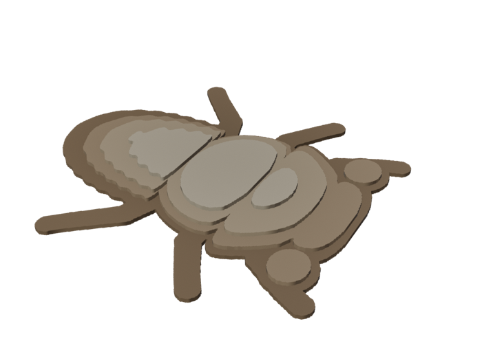
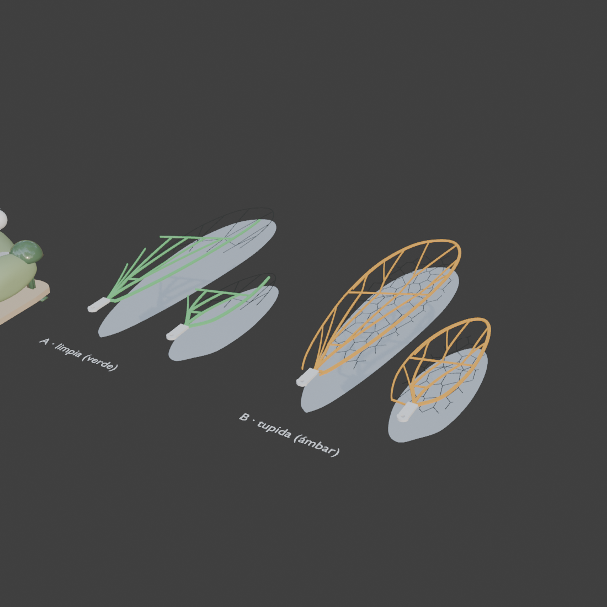
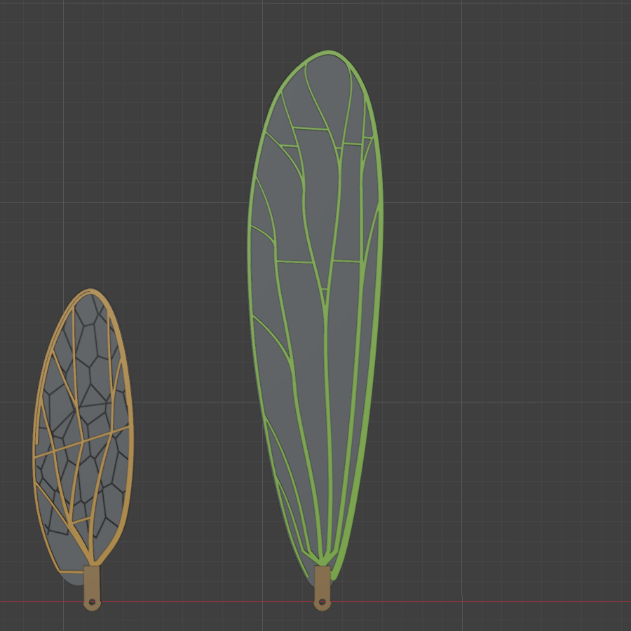
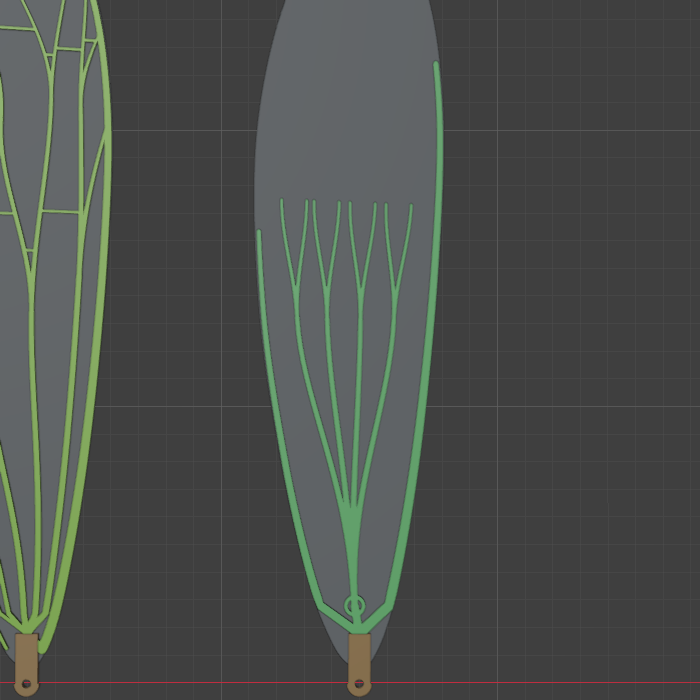
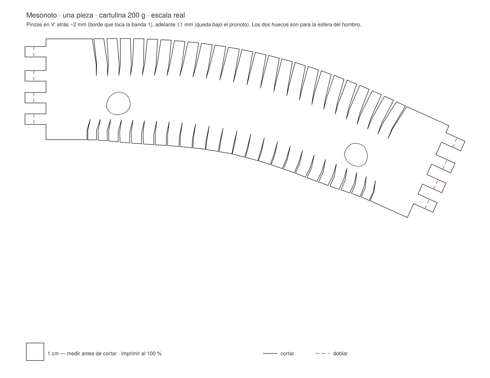
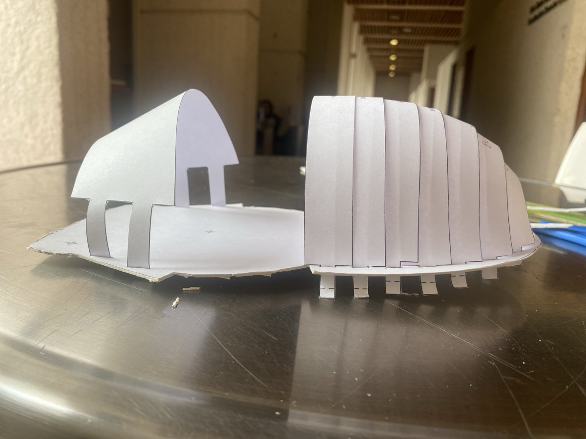
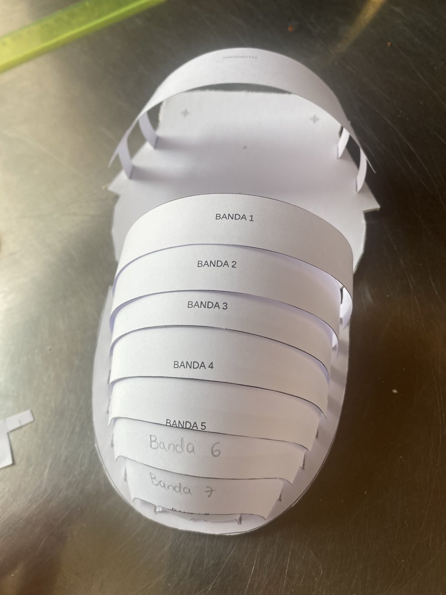

# Cigarra para armar

Proyecto final de **Computación Visual Interactiva** (Universidad de los Andes, 2026-2) · Sara Cuadrado ·
Prof. Pablo Figueroa.

Un pipeline en Python + Blender que convierte el modelo 3D de una cigarra en un **kit de cartón para armar
sin pegante**: un relieve para colgar en la pared, de 30 cm de envergadura, con los archivos listos para
el corte láser y su manual de armado.

| Modelo 3D en Blender | Curvas de nivel (piezas del kit) | Maqueta del kit armado |
|:---:|:---:|:---:|
|  |  |  |

## Novedad v0.4: alas procedurales, hombro articulado y mesonoto

Las alas ahora se mueven. Cada ala se arma de 3 piezas, y todo sale de scripts que corren dentro de
`Mecanismo_Alas.blend` (en [`mecanismo/`](mecanismo/)):

1. **Estructura** (PLA, impresión 3D): las venas gruesas y la raíz que entra al hombro, en una sola pieza.
2. **Membrana** (acetato o papel, corte): el contorno transparente.
3. **Adhesivo** (vinilo o papel adhesivo): las venas finas, pegadas sobre la membrana.

| Propuestas A y B (las 3 piezas separadas) | C · orgánica | D · regla de Sara |
|:---:|:---:|:---:|
|  |  |  |

**Cómo se generan las venas** ([`mecanismo/alas_procedurales.py`](mecanismo/alas_procedurales.py)):

- **Coordenadas del ala (u, v):** u recorre el ala de la base al ápice, medido con `longitud_arco` sobre
  cada borde; v va de la costa al borde de fuga. Una vena con v constante corre paralela al contorno,
  y todas se cierran en el ápice.
- **Bifurcaciones en Y suave:** entre bifurcaciones v cambia con *smoothstep*, así cada rama sale con la
  dirección de su madre; el último tramo cae al borde con t², en ángulo.
- **Regla recursiva** ([`mecanismo/mis_reglas.py`](mecanismo/mis_reglas.py), escrita por Sara): *una vena
  crece y luego se divide en dos venas más pequeñas*. La función `bifurcar` se llama a sí misma; cambiar
  `D_GENERACIONES` o `D_ABERTURA` da otra ala con la misma regla.
- **Red secundaria (versión B):** diagrama de Voronoi, el dual de una triangulación de Delaunay de puntos
  al azar, calculado en un espacio estirado para que las celdas salgan alargadas.

**El hombro** ([`mecanismo/produccion_prueba.py`](mecanismo/produccion_prueba.py)), inspirado en el hombro
de un maniquí: una esfera de 20 mm que gira sobre un tornillo M3 a lo largo de un **eje oblicuo**. El eje se
calculó a partir de las dos poses del ala, la de reposo como techo y la de exhibición abierta, con el
teorema de rotación de Euler. Las raíces quedan a 16° del eje, así que:

- la esfera se imprime en **4 rodajas** apiladas en el tornillo, cada una con su bolsillo;
- la raíz anterior va **fija**; la posterior va en un **abanico de 35°**: el ala anterior gira sola y luego
  la arrastra (giro desfasado). La lengüeta del soporte entra por un abanico de 105°;
- cada raíz lleva un **agujero oblicuo** para el tornillo, y los bolsillos se calculan barriendo cada pieza
  a lo largo de la animación (unión por vóxeles). Sin choques en todo el recorrido (BVH).

**El mesonoto** ([`mecanismo/mesonoto/`](mecanismo/mesonoto/)) tiene doble curvatura, así que no se puede
desarrollar exacto. Cortarlo en franjas transversales pedía pinzas de 34 mm; en franjas a lo largo del
cuerpo, unidas por el centro, las pinzas miden 2 mm o menos. Sale una sola pieza con pinzas en V cortas,
pestañas al chasis y los huecos de la esfera (el corte exacto de la esfera con la superficie).



**Prueba de impresión** en [`salida/v0.4_prueba_impresion/`](salida/v0.4_prueba_impresion/): los STL de la
versión C (alas anterior y posterior, esfera en 4 rodajas, soporte) y 4 hojas carta para imprimir al 100 %
(membranas, mesonoto y guía de ranuras para el chasis). Tornillería: M3 × 18 cabeza botón (ISO 7380) y
tuerca M3 (DIN 934).

## Novedad v0.3: piezas con volumen (desarrollo de superficies)

Las capas planas apiladas (el pipeline de abajo) perdían el volumen de la cigarra. Desde esta versión el
abdomen y el pronoto se fabrican como **bandas curvas**: el script las **aplana** en una plantilla y, al
encajar sus pestañas en el chasis, la cartulina recupera sola la curva del modelo. Todo se arma sin
pegante.

| Prototipo en cartulina, de lado | Prototipo en cartulina, desde arriba |
|:---:|:---:|
|  |  |

Cómo lo hace [`desarrollo/plantillas_cigarra.py`](desarrollo/plantillas_cigarra.py):

1. **Longitud de arco** (`longitud_arco`, escrita por Sara): suma de las distancias entre puntos
   consecutivos de la curva, como medir el lomo con un metro de costurera.
2. **Desarrollo por triangulación**: la banda se parte en triángulos entre sus cortes transversales y
   cada triángulo se coloca en el plano conservando la longitud de sus tres lados (intersección de dos
   circunferencias, "triangular con compás"). Las bandas resultaron ser **troncos de cono**, no
   cilindros: su borde de adelante es más largo que el de atrás, por eso abiertas tienen forma de arco.
3. **Verificación**: se compara la diagonal que no se usó. Error 0 = la pieza se abre sin deformarse
   (superficie desarrollable). Las 8 bandas y el pronoto dan **0,00 mm**.
4. **Ranuras**: cada ranura del chasis se dibuja sobre el pie real de su pestaña, con su ancho y su
   **ángulo** (en la cola el pie corre en diagonal).
5. **Piezas planas**: chasis y patas proyectados desde arriba (las patas se unen antes con un booleano).

Salida en [`salida/desarrollo/`](salida/desarrollo/): 5 hojas carta (SVG en mm y PDF), hojas 1–3 en
cartulina 200 g y hojas 4–5 como guía para cortar cartón de 1,5 mm. Se corre con el `.blend` del
prototipo abierto (objetos `Cigarra_H`), desde *Scripting → Text → Open → Run*.

## El pipeline, paso a paso (v0.1–v0.2: capas planas)

1. **Entrada** (`cigarra/entrada.py`): toma la cigarra de la escena, le **quita las alas** (van aparte,
   generadas por algoritmo) y junta el cuerpo en una sola malla, en el marco propio del insecto.
2. **Vista desde arriba** (`cigarra/vista.py`): lanza un rayo vertical por cada píxel de 0,25 mm y guarda
   la altura del primer punto que toca. Es una cámara ortográfica que, en vez de colores, guarda alturas:
   un mapa de alturas. Son 212 660 rayos en menos de medio segundo.
3. **Chasis** (`cigarra/curvas_nivel.py`): la silueta de esa vista, con 1,5 mm de margen, es la primera
   pieza. Su borde se traza con *marching squares* y se limpia con *Douglas–Peucker* (de 3 176 a 766
   puntos, con error de 0,1 mm o menos).
4. **Capas** (`cigarra/curvas_nivel.py`): el mapa de alturas se corta por **cuantiles**, como curvas de
   nivel, para que cada capa cubra la misma área (75, 50 y 25 % del cuerpo). Cada capa queda dentro de la
   de abajo, y se descartan las partes más angostas que el láser o más pequeñas que 25 mm².
5. **Exportar** (`cigarra/exportar.py`): cada nivel sale como SVG a escala real, en milímetros, con la
   cabeza hacia arriba como cuelga en la pared (rojo = corte, azul = grabado). Resultado: 8 piezas en
   [`salida/`](salida/).
6. **Maqueta** (`cigarra/maqueta.py`): las mismas piezas, con el grosor del cartón, apiladas en Blender
   para ver cómo se ve el kit antes de cortarlo.
7. **Árbol de armado y manual** (`cigarra/armado.py`): cada pieza es un nodo y su padre es la pieza sobre
   la que va; la raíz es el chasis. Para hallar el padre basta un píxel de la pieza: cada pieza es una isla
   conectada y las de abajo no se tocan, así que queda sobre una sola. Recorrer el árbol capa por capa
   (BFS) da los pasos del manual, en [`salida/manual.txt`](salida/manual.txt):

   ```
   chasis                       Paso 1: chasis (la base)
   ├─ capa_1_a  (cuerpo)        Paso 2: capa_1_a sobre chasis
   │  └─ capa_2_a               Paso 3: capa_1_b sobre chasis
   │     ├─ capa_3_a            Paso 4: capa_1_c sobre chasis
   │     ├─ capa_3_b            Paso 5: capa_2_a sobre capa_1_a
   │     └─ capa_3_c            Paso 6: capa_3_a sobre capa_2_a
   ├─ capa_1_b  (ojo)           Paso 7: capa_3_b sobre capa_2_a
   └─ capa_1_c  (ojo)           Paso 8: capa_3_c sobre capa_2_a
   ```

Antes de cortar el kit, [`salida/peineta_prueba.svg`](salida/peineta_prueba.svg) sirve para calibrar la
holgura de las ranuras con el láser real (`cigarra/peineta.py`).

Todos los números del kit (escala, grosores, holguras, anchos mínimos) están en un solo archivo:
[`cigarra/config.py`](cigarra/config.py).

## Cómo ejecutarlo

Solo hace falta **Blender 5.2**, que trae su propio Python con numpy. Desde la carpeta del repositorio:

```bash
/Applications/Blender.app/Contents/MacOS/Blender -b --factory-startup --python legado/cigarra_base.py --python correr_en_blender.py
```

`legado/cigarra_base.py` construye la cigarra en una escena vacía y `correr_en_blender.py` corre el
pipeline: escribe los SVG en `salida/` e imprime un resumen por capa. Tarda unos 5 segundos. (En Windows
o Linux, cambia la ruta por la de tu instalación de Blender.)

Para ver además la **maqueta 3D**, con Blender abierto y la cigarra en la escena, en *Scripting → Python
Console*:

```python
import runpy; runpy.run_path("<ruta>/cigarra-kit/correr_en_blender.py", run_name="__main__")
```

La maqueta aparece en la colección `Maqueta_Capas`.

**Peineta de prueba** (no necesita Blender ni numpy):

```bash
python3 -m cigarra.peineta
```

**Pruebas automáticas** (29 pruebas, con el Python de Blender):

```bash
/Applications/Blender.app/Contents/Resources/5.2/python/bin/python3.13 -m unittest -v
```

## Estructuras de datos por módulo

Las secciones son de **Marschner y Shirley, *Fundamentals of Computer Graphics*, 5.ª edición** (CRC Press,
2021). Un "—" quiere decir que esa técnica no sale del libro.

| Módulo | Estructura de datos | Para qué | Libro |
|---|---|---|---|
| `entrada` | Malla de triángulos en **lista indexada** | Guardar el cuerpo como tabla de vértices + triángulos | 12.1 |
| `entrada` | Jerarquía de transformaciones (grafo de escena) | Llevar cada pieza al marco propio de la cigarra | 12.2 |
| `vista` | **Proyección ortográfica** (cámara desde arriba) | Mirar sin perspectiva: todos los rayos van paralelos, hacia abajo | 8 |
| `vista` | **BVH** (jerarquía de cajas envolventes) | Que cada rayo descarte grupos enteros de triángulos | 12.3 |
| `vista` | **Arreglo 2D** (mapa de alturas = **z-buffer**) | Guardar la altura de lo primero que ve cada píxel | 12.5 · 9 (z-buffer) |
| `curvas_nivel` | Cuantiles sobre el arreglo 2D | Cortar capas de igual área (curvas de nivel) | — |
| `curvas_nivel` | Grafo de vecindad de píxeles + **BFS** | Contar islas: cada isla es una pieza física | — |
| `curvas_nivel` | Morfología (dilatación, erosión, apertura) | Margen del chasis y zonas más angostas que el láser | — |
| `curvas_nivel` | Polilíneas cerradas (*marching squares*, *Douglas–Peucker*) | Pasar de píxeles a líneas de corte | — |
| `exportar` | Lienzo vectorial en milímetros | SVG a escala real para el láser | — |
| `armado` | **Árbol** (nodo = pieza, padre = pieza de abajo) | Saber qué pieza va sobre cuál | — |
| `armado` | **Fila** (cola) + **BFS** sobre el árbol | Pasos del manual, capa por capa | — |

## Estado actual

**Funciona**
- El pipeline de punta a punta: chasis y 3 capas en SVG, listos para el láser.
- Maqueta 3D del kit en Blender.
- Peineta de prueba para calibrar la holgura.
- El árbol de armado de las 8 piezas y los 8 pasos del manual.
- 29 pruebas automáticas (medidas de las ranuras, capas una dentro de otra, contornos, árbol y manual).

**Sigue**
1. Cortar la peineta en láser y fijar la holgura real en `config.py`.
2. Uniones sin pegante (ranura + pestaña) entre cada pieza y su padre en el árbol.
3. Probar en físico el hombro, las alas impresas y el mesonoto (v0.4).
4. Textura proyectada en perspectiva desde el punto de vista del observador.

## Estructura del repositorio

```
mecanismo/          v0.4: alas procedurales, hombro articulado y mesonoto (scripts de Blender)
desarrollo/         v0.3: plantillas de las piezas con volumen (bandas, pronoto, chasis, patas)
cigarra/            el pipeline de capas planas, un módulo por paso (ver arriba)
pruebas/            pruebas automáticas (unittest)
salida/             SVG listos para el láser (chasis, capas 1–3 y peineta) y manual.txt
salida/desarrollo/  v0.3: las 5 hojas de plantillas (SVG en mm + PDF para imprimir)
salida/v0.4_prueba_impresion/  STL de la prueba 3D y hojas de membranas y mesonoto
correr_en_blender.py  corre todo el pipeline dentro de Blender
legado/             scripts del primer prototipo (modelo base, modelo híbrido, shadow box, calco de alas)
docs/               plan de construcción e imágenes de este README
```
