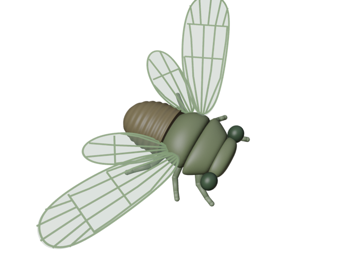
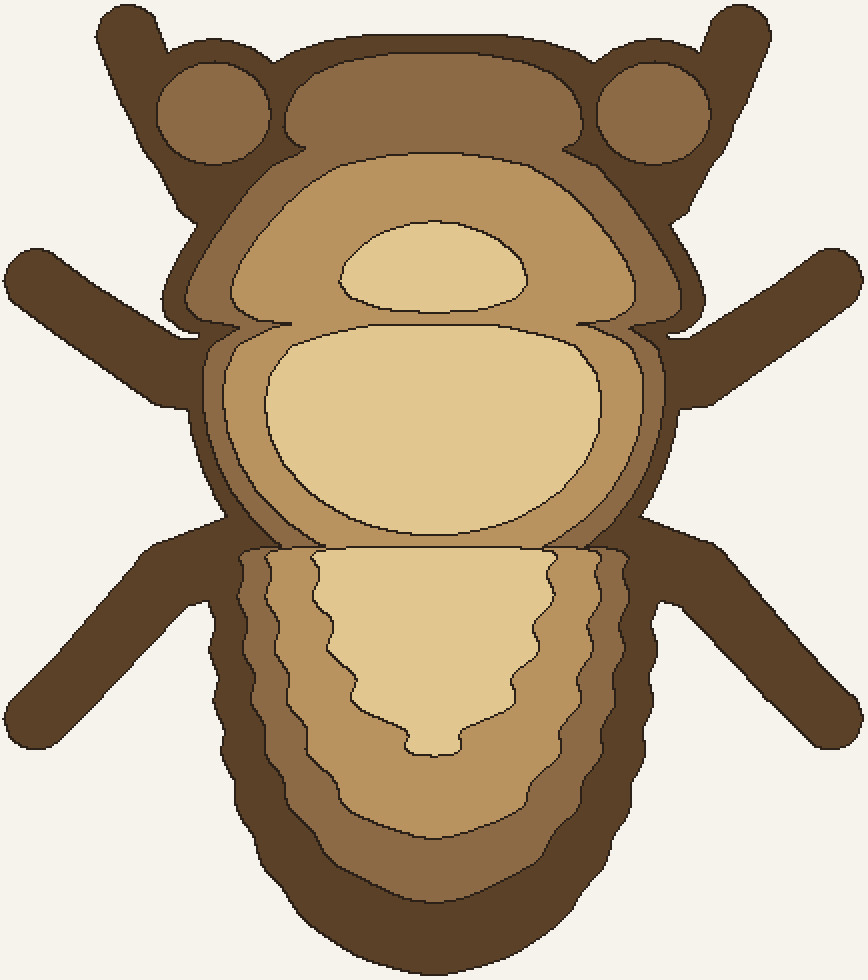

# Cigarra para armar

Proyecto final de **Computación Visual Interactiva** (Universidad de los Andes, 2026-2) · Sara Cuadrado ·
Prof. Pablo Figueroa.

Un pipeline en Python + Blender que convierte el modelo 3D de una cigarra en un **kit de cartón para armar
sin pegante**: un relieve para colgar en la pared, de 30 cm de envergadura, con los archivos listos para
el corte láser y su manual de armado.

| Modelo 3D en Blender | Curvas de nivel (piezas del kit) | Maqueta del kit armado |
|:---:|:---:|:---:|
|  |  |  |

## El pipeline, paso a paso

1. **Entrada** (`cigarra/entrada.py`): toma la cigarra de la escena, le **quita las alas** (van aparte,
   generadas por algoritmo) y junta el cuerpo en una sola malla, en el marco propio del insecto.
2. **Vista desde arriba** (`cigarra/vista.py`): lanza un rayo vertical por cada píxel de 0,25 mm y guarda
   la altura del primer punto que toca. Es una cámara ortográfica que, en vez de colores, guarda alturas:
   un mapa de alturas. Son 212 660 rayos en menos de medio segundo.
3. **Chasis** (`cigarra/curvas_nivel.py`): la silueta de esa vista, con 1,5 mm de margen, es la primera
   pieza. Su borde se traza con *marching squares* y se limpia con *Douglas–Peucker* (de 3 176 a 766
   puntos, con error de 0,1 mm o menos).
4. **Capas** (`cigarra/curvas_nivel.py`): el mapa de alturas se corta por **cuantiles**, como curvas de
   nivel, para que cada capa cubra la misma área (75, 50 y 25 % del cuerpo). Cada capa queda dentro de la
   de abajo, y se descartan las partes más angostas que el láser o más pequeñas que 25 mm².
5. **Exportar** (`cigarra/exportar.py`): cada nivel sale como SVG a escala real, en milímetros, con la
   cabeza hacia arriba como cuelga en la pared (rojo = corte, azul = grabado). Resultado: 8 piezas en
   [`salida/`](salida/).
6. **Maqueta** (`cigarra/maqueta.py`): las mismas piezas, con el grosor del cartón, apiladas en Blender
   para ver cómo se ve el kit antes de cortarlo.
7. **Árbol de armado y manual** (`cigarra/armado.py`): cada pieza es un nodo y su padre es la pieza sobre
   la que va; la raíz es el chasis. Para hallar el padre basta un píxel de la pieza: cada pieza es una isla
   conectada y las de abajo no se tocan, así que queda sobre una sola. Recorrer el árbol capa por capa
   (BFS) da los pasos del manual, en [`salida/manual.txt`](salida/manual.txt):

   ```
   chasis                       Paso 1: chasis (la base)
   ├─ capa_1_a  (cuerpo)        Paso 2: capa_1_a sobre chasis
   │  └─ capa_2_a               Paso 3: capa_1_b sobre chasis
   │     ├─ capa_3_a            Paso 4: capa_1_c sobre chasis
   │     ├─ capa_3_b            Paso 5: capa_2_a sobre capa_1_a
   │     └─ capa_3_c            Paso 6: capa_3_a sobre capa_2_a
   ├─ capa_1_b  (ojo)           Paso 7: capa_3_b sobre capa_2_a
   └─ capa_1_c  (ojo)           Paso 8: capa_3_c sobre capa_2_a
   ```

Antes de cortar el kit, [`salida/peineta_prueba.svg`](salida/peineta_prueba.svg) sirve para calibrar la
holgura de las ranuras con el láser real (`cigarra/peineta.py`).

Todos los números del kit (escala, grosores, holguras, anchos mínimos) están en un solo archivo:
[`cigarra/config.py`](cigarra/config.py).

## Cómo ejecutarlo

Solo hace falta **Blender 5.2**, que trae su propio Python con numpy. Desde la carpeta del repositorio:

```bash
/Applications/Blender.app/Contents/MacOS/Blender -b --factory-startup --python legado/cigarra_base.py --python correr_en_blender.py
```

`legado/cigarra_base.py` construye la cigarra en una escena vacía y `correr_en_blender.py` corre el
pipeline: escribe los SVG en `salida/` e imprime un resumen por capa. Tarda unos 5 segundos. (En Windows
o Linux, cambia la ruta por la de tu instalación de Blender.)

Para ver además la **maqueta 3D**, con Blender abierto y la cigarra en la escena, en *Scripting → Python
Console*:

```python
import runpy; runpy.run_path("<ruta>/cigarra-kit/correr_en_blender.py", run_name="__main__")
```

La maqueta aparece en la colección `Maqueta_Capas`.

**Peineta de prueba** (no necesita Blender ni numpy):

```bash
python3 -m cigarra.peineta
```

**Pruebas automáticas** (29 pruebas, con el Python de Blender):

```bash
/Applications/Blender.app/Contents/Resources/5.2/python/bin/python3.13 -m unittest -v
```

## Estructuras de datos por módulo

Las secciones son de **Marschner y Shirley, *Fundamentals of Computer Graphics*, 5.ª edición** (CRC Press,
2021). Un "—" quiere decir que esa técnica no sale del libro.

| Módulo | Estructura de datos | Para qué | Libro |
|---|---|---|---|
| `entrada` | Malla de triángulos en **lista indexada** | Guardar el cuerpo como tabla de vértices + triángulos | 12.1 |
| `entrada` | Jerarquía de transformaciones (grafo de escena) | Llevar cada pieza al marco propio de la cigarra | 12.2 |
| `vista` | **Proyección ortográfica** (cámara desde arriba) | Mirar sin perspectiva: todos los rayos van paralelos, hacia abajo | 8 |
| `vista` | **BVH** (jerarquía de cajas envolventes) | Que cada rayo descarte grupos enteros de triángulos | 12.3 |
| `vista` | **Arreglo 2D** (mapa de alturas = **z-buffer**) | Guardar la altura de lo primero que ve cada píxel | 12.5 · 9 (z-buffer) |
| `curvas_nivel` | Cuantiles sobre el arreglo 2D | Cortar capas de igual área (curvas de nivel) | — |
| `curvas_nivel` | Grafo de vecindad de píxeles + **BFS** | Contar islas: cada isla es una pieza física | — |
| `curvas_nivel` | Morfología (dilatación, erosión, apertura) | Margen del chasis y zonas más angostas que el láser | — |
| `curvas_nivel` | Polilíneas cerradas (*marching squares*, *Douglas–Peucker*) | Pasar de píxeles a líneas de corte | — |
| `exportar` | Lienzo vectorial en milímetros | SVG a escala real para el láser | — |
| `armado` | **Árbol** (nodo = pieza, padre = pieza de abajo) | Saber qué pieza va sobre cuál | — |
| `armado` | **Fila** (cola) + **BFS** sobre el árbol | Pasos del manual, capa por capa | — |

## Estado actual

**Funciona**
- El pipeline de punta a punta: chasis y 3 capas en SVG, listos para el láser.
- Maqueta 3D del kit en Blender.
- Peineta de prueba para calibrar la holgura.
- El árbol de armado de las 8 piezas y los 8 pasos del manual.
- 29 pruebas automáticas (medidas de las ranuras, capas una dentro de otra, contornos, árbol y manual).

**Sigue**
1. Cortar la peineta en láser y fijar la holgura real en `config.py`.
2. Uniones sin pegante (ranura + pestaña) entre cada pieza y su padre en el árbol.
3. Alas generadas por algoritmo: venas que se ramifican (fractal) y celdas de Voronoi.
4. Textura proyectada en perspectiva desde el punto de vista del observador.

## Estructura del repositorio

```
cigarra/            el pipeline, un módulo por paso (ver arriba)
pruebas/            pruebas automáticas (unittest)
salida/             SVG listos para el láser (chasis, capas 1–3 y peineta) y manual.txt
correr_en_blender.py  corre todo el pipeline dentro de Blender
legado/             scripts del primer prototipo (modelo base, modelo híbrido, shadow box, calco de alas)
docs/               plan de construcción e imágenes de este README
```
